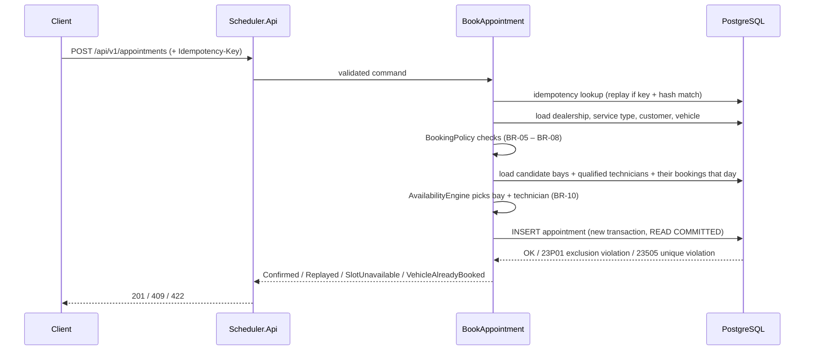

# SPEC: Unified Service Scheduler (Keyloop Assessment – Scenario A)
Version: 1.0 | Owner: Duong Dinh Hanh | Last updated: 2026-11-03 | Status: Approved – ready for implementation

## 0. Revision History
| Version | Date | Change |
|---|---|---|
| 1.0 | 2026-11-03 | Initial approved spec for Keyloop Scenario A |

## 1. Context & Goals
- **Problem statement:** Dealerships book service appointments manually (phone, spreadsheets),
  causing double-booked bays, unqualified technicians assigned to jobs, and no single record
  of who/what/when.
- **Target users:**
  - Customer / Service Advisor: requests an appointment for a vehicle
  - Dealership staff: views confirmed appointments
- **Success criteria (verified by automated tests):**
  - Zero double-bookings of a ServiceBay, Technician or Vehicle, including under concurrent requests (AC-02.x)
  - Every confirmed appointment links customer, vehicle, technician, bay and time window (AC-01.2)
- **Performance targets (verified by load script, see §10):**
  - POST /appointments p95 < 500 ms; GET /availability p95 < 300 ms

### Mapping to Keyloop Core Requirements
| Keyloop requirement | Covered by |
|---|---|
| 1. Resource Constrained Booking | FR-01, BR-05 – BR-09 |
| 2. Real-Time Availability Check (bay + qualified technician, entire duration) | FR-02, BR-01 – BR-04, BR-11 |
| 3. Confirmed Appointment Record (customer, vehicle, technician, bay) | FR-03, FR-04 |

## 2. Scope
### In scope
- Backend RESTful API with persistent database (Keyloop Part 2: Backend option)
- Request appointment → real-time availability check → confirmed appointment record
- Availability query (open start times for a day)
- Alternative start time suggestions when a slot is taken
- Cancel appointment (frees resources)
- Idempotent booking via `Idempotency-Key`
- Read-only reference data: dealerships, service types, a customer's vehicles
- Seed data, OpenAPI spec, Swagger UI, `.http` file and cURL examples as client stub
- Observability: structured logs, metrics, traces, health checks

### Out of scope (the AI must NOT implement)
- Frontend UI (stubbed via OpenAPI / Swagger UI and `.http` files)
- Real authentication / authorization (caller identity passed in request, see A-07)
- Payments, notifications (email/SMS), reminders
- Rescheduling (modelled as cancel + new booking)
- Admin CRUD for dealerships, bays, technicians, service types (seed data only)
- Technician shifts, breaks, leave; bay maintenance windows; public holidays
- Multi-step approval workflow (bookings are confirmed instantly, see A-01)

## 3. Tech Stack & Constraints
| Area | Choice | Justification |
|---|---|---|
| Runtime | .NET 10 (LTS), ASP.NET Core Web API with Controllers (`[ApiController]`), C# 14 | Current LTS; controllers give a familiar, conventional structure per resource, built-in model validation, attribute routing and rich OpenAPI metadata via `[ProducesResponseType]` |
| Database | PostgreSQL 16 | `tstzrange` + exclusion constraints give a DB-level no-overlap guarantee |
| ORM | EF Core 10 + Npgsql | LINQ data access and mapping |
| Schema migrations | Forward-only SQL scripts, embedded and applied on start-up by `DatabaseMigrator` | Exclusion constraints and range types are raw SQL anyway; scripts are reviewable |
| Validation | Hand-written `BookAppointmentValidator` | One request type; keeps Domain/Application free of third-party packages |
| Logging | Serilog (JSON to console) | Structured logs, correlation IDs |
| Metrics / Tracing | OpenTelemetry (OTLP exporter, console exporter in dev) | Vendor-neutral |
| API docs | `Microsoft.AspNetCore.OpenApi` (OpenAPI 3.1) + Swagger UI | First-party document generation; serves as client contract stub |
| Testing | xUnit, FluentAssertions, Testcontainers (PostgreSQL), WebApplicationFactory, Coverlet | Real DB in integration tests |
| Load test | k6 script in `perf/` (external tool, not a NuGet package) | Verifies §10 performance targets |
| Object mapping | AutoMapper 16.x, Api layer only, no license key (OQ-15) | Team familiarity; removes hand-written DTO → response mapping. 14.x is vulnerable (GHSA-rvv3-g6hj-g44x). Without a key AutoMapper works and logs a licence warning; production use needs a key (free Community licence below $5M revenue) |
| Packaging | Docker Compose (api + postgres) | One-command run |

Constraints:
- Not allowed: MediatR, in-memory EF provider or SQLite for integration tests
- AutoMapper is referenced by `Scheduler.Api` only; it must not be used to create or modify Domain entities
- Domain and Application projects reference no NuGet packages (BCL only)
- All versions central in `Directory.Packages.props`; vulnerable transitive packages pinned there
  (`CentralPackageTransitivePinningEnabled`). `NU190x` audit warnings are errors and must never be suppressed
- `TreatWarningsAsErrors` enabled for all projects
- API layer uses Controllers only (no Minimal API endpoints, except `MapHealthChecks` for `/health/*`)
- All timestamps stored in UTC (`timestamptz`); API accepts ISO 8601 **with offset only**
- No new NuGet packages beyond this list without being raised as an Open Question

## 4. Architecture & Folder Structure
```
src/
  Scheduler.Api/             # Controllers, DI, middleware, exception handler, ProblemDetails mapping, OpenAPI
    Controllers/             # AppointmentsController, AvailabilityController, ReferenceDataController
    Contracts/               # Request / response models (API DTOs)
    Mapping/                 # AutoMapper profiles (AppointmentProfile, ReferenceDataProfile): Application DTO → API response
  Scheduler.Application/     # Use cases (BookAppointment, GetAvailability, CancelAppointment), DTOs, validators
  Scheduler.Domain/          # Entities, value objects (TimeSlot), BookingPolicy, AvailabilityEngine, domain errors
  Scheduler.Infrastructure/  # DbContext, SQL migrations + migrator, store implementations, seed data
tests/
  Scheduler.UnitTests/         # Domain + Application logic, no DB
  Scheduler.IntegrationTests/  # API + PostgreSQL via Testcontainers
docs/
  system-design.md           # Keyloop System Design Document
  ai-collaboration-log.md    # Step-by-step AI log (source for README narrative)
http/
  scheduler.http             # Client stub: sample requests
perf/
  booking.k6.js              # Load script for §10 targets
docker-compose.yml
SPEC.md
AGENTS.md
README.md
```
- Dependency rule: Api → Application → Domain ← Infrastructure. Domain references nothing.
- `AvailabilityEngine` and `BookingPolicy` are pure domain services (no I/O) so they are fully unit-testable.
- Application defines store interfaces (`IAppointmentStore`, `IReferenceDataStore`); Infrastructure implements them.

### Booking flow


## 5. Domain Model
| Entity | Field | Type | Constraints |
|---|---|---|---|
| Dealership | Id | Guid | PK |
| Dealership | Name | string(200) | required |
| Dealership | TimeZone | string | IANA, e.g. `Asia/Ho_Chi_Minh` |
| Dealership | OpeningTime / ClosingTime | TimeOnly | Opening < Closing (no overnight hours) |
| Dealership | OpenDays | DayOfWeek[] | e.g. Mon–Sat |
| ServiceBay | Id, DealershipId, Name | Guid, Guid, string(50) | FK Dealership; (DealershipId, Name) unique |
| ServiceBay | BayType | enum | `General`, `Lift`, `Diagnostic` |
| ServiceBay | IsActive | bool | inactive bays never allocated |
| Technician | Id, DealershipId, FullName | Guid, Guid, string(200) | FK Dealership |
| Technician | Qualifications | Qualification[] | `General`, `Brakes`, `Diagnostics`, `HighVoltage` |
| Technician | IsActive | bool | inactive technicians never allocated |
| ServiceType | Id, Code, Name | Guid, string(50), string(200) | Code unique, e.g. `OIL_CHANGE` |
| ServiceType | DurationMinutes | int | 15–480, multiple of 15 |
| ServiceType | RequiredQualification | Qualification | |
| ServiceType | RequiredBayType | BayType | |
| Customer | Id, FullName, Email, Phone | Guid, string, string, string | Email unique |
| Vehicle | Id, Vin, Make, Model, Year, CustomerId | | VIN 17 chars, unique; FK Customer |
| Appointment | Id | Guid | PK |
| Appointment | CustomerId, VehicleId, DealershipId, ServiceTypeId | Guid | FKs |
| Appointment | TechnicianId, ServiceBayId | Guid | FKs |
| Appointment | StartUtc, EndUtc | timestamptz | End = Start + Duration |
| Appointment | Status | enum | `Confirmed`, `Cancelled` |
| Appointment | Notes | string(500)? | optional |
| Appointment | CreatedAtUtc, CancelledAtUtc | timestamptz | |
| Appointment | IdempotencyKey | string(100)? | unique when not null |
| Appointment | RequestHash | string(64)? | SHA-256 of the canonical request body |

### Business Rules
- **BR-01 Duration:** `End = Start + ServiceType.DurationMinutes`. Windows are half-open `[Start, End)`,
  so back-to-back appointments (one ends 10:00, next starts 10:00) do NOT overlap.
- **BR-02 Bay availability:** A ServiceBay is available if it belongs to the requested dealership,
  is active, matches `RequiredBayType`, and has no `Confirmed` appointment overlapping the window.
- **BR-03 Technician availability:** A Technician is available if they belong to the requested
  dealership, are active, hold `RequiredQualification`, and have no `Confirmed` appointment overlapping the window.
- **BR-04 Both or nothing:** A booking is confirmed only if at least one available bay AND one
  available technician exist for the ENTIRE window.
- **BR-05 Opening hours:** The whole window must fall within opening hours on an open day, evaluated in
  the dealership's time zone using IANA conversion. For zones with DST, a local time that does not exist
  or is ambiguous is rejected as `OUTSIDE_OPENING_HOURS`.
- **BR-06 Booking horizon:** Start must be at least 60 minutes after "now" and at most 60 days after "now"
  ("now" from injected `TimeProvider`).
- **BR-07 Slot granularity:** Start must align to a 15-minute boundary (:00, :15, :30, :45) with seconds
  and fractional seconds equal to zero.
- **BR-08 Vehicle ownership:** The vehicle must belong to the requesting customer.
- **BR-09 Vehicle no-overlap:** A vehicle cannot have two overlapping `Confirmed` appointments,
  across all dealerships.
- **BR-10 Allocation strategy:** When several resources are available:
  - Technician: fewest booked minutes on the same local calendar day (dealership time zone),
    tie-break by lowest Id.
  - Bay: lowest Name (ordinal comparison), tie-break by lowest Id.
- **BR-11 Concurrency guarantee:** Under concurrent requests for the same resource and window, at most one
  succeeds. Enforced at DB level by exclusion constraints (§10), not only in code.
- **BR-12 Cancellation:** Only `Confirmed` appointments whose start is in the future can be cancelled.
  Cancelled appointments no longer block resources.

### Error evaluation order (POST /appointments)
The first failing check decides the response. Checks run in this order:
1. Request shape and required fields → 400 `VALIDATION_FAILED`
2. Start time offset present and 15-minute aligned → 400 `INVALID_START_TIME`
3. Idempotency replay / key reuse (FR-08)
4. Referenced entities exist: customer → vehicle → dealership → service type → 404 `*_NOT_FOUND`
5. Vehicle ownership → 422 `VEHICLE_NOT_OWNED`
6. Booking horizon → 422 `OUTSIDE_BOOKING_HORIZON`
7. Opening hours → 422 `OUTSIDE_OPENING_HOURS`
8. Vehicle overlap → 409 `VEHICLE_ALREADY_BOOKED`
9. Bay + technician allocation → 409 `SLOT_UNAVAILABLE` (with suggestions)

## 6. Functional Requirements
| ID | Requirement | Priority | Related BR |
|---|---|---|---|
| FR-01 | Request a service appointment for a vehicle, service type, dealership and desired start time | Must | BR-01, BR-05 – BR-08 |
| FR-02 | Check availability of a qualified technician and a compatible bay for the entire duration before confirming | Must | BR-02 – BR-04, BR-09, BR-11 |
| FR-03 | On success, persist a Confirmed appointment linking customer, vehicle, technician, bay and time window | Must | BR-10 |
| FR-04 | Retrieve an appointment by Id | Must | - |
| FR-05 | When the slot is unavailable, return up to 3 alternative start times later on the same local day, free for the bay, technician AND the requested vehicle | Should | BR-02 – BR-07, BR-09 |
| FR-06 | Query available start times for a dealership, service type and date (resource availability only; vehicle not considered) | Should | BR-02 – BR-07 |
| FR-07 | Cancel an appointment, releasing its bay and technician | Should | BR-12 |
| FR-08 | Support an `Idempotency-Key` header so retried booking requests do not create duplicates | Should | - |
| FR-09 | List reference data: dealerships, service types, a customer's vehicles | Could | - |

## 7. Acceptance Criteria
Format: Given / When / Then.

**Fixed test context:** `TimeProvider` is frozen at **Mon 2026-11-09 08:00 +07:00**.
Seed data defines Dealership D1 (open Mon–Sat 08:00–17:00, `Asia/Ho_Chi_Minh`) and service type
`OIL_CHANGE` (60 min, qualification `General`, bay `Lift`). "Tue" below means **Tue 2026-11-10**.
Each test arranges its own bays, technicians and bookings unless stated otherwise.

### FR-01 / FR-02 / FR-03 / FR-04: Book appointment
| ID | Given | When | Then |
|---|---|---|---|
| AC-01.1 | 1 free Lift bay and 1 free qualified technician at D1 on Tue 09:00–10:00 | POST for Tue 09:00 OIL_CHANGE | 201, status `Confirmed`, end = 10:00, response includes technician and serviceBay |
| AC-01.2 | AC-01.1 succeeded | GET /appointments/{id} | Record contains customer, vehicle, technician, bay, start, end, status |
| AC-01.3 | Only Lift bay booked 09:30–10:30, technician free | POST for 09:00 | 409 `SLOT_UNAVAILABLE` |
| AC-01.4 | Bay free, only qualified technician booked 08:30–09:30 | POST for 09:00 | 409 `SLOT_UNAVAILABLE` |
| AC-01.5 | Bay free, only free technician lacks `General` | POST for 09:00 | 409 `SLOT_UNAVAILABLE` |
| AC-01.6 | Bay and technician booked 08:00–09:00 | POST for 09:00 | 201 (half-open intervals, BR-01) |
| AC-01.7 | Only free bay is `General`, not `Lift` | POST for 09:00 | 409 `SLOT_UNAVAILABLE` |
| AC-01.8 | Technicians T1 (120 booked minutes Tue) and T2 (0) both free | POST for 09:00 | 201, assigned to T2 (BR-10) |
| AC-01.9 | Two free Lift bays "Bay 1" and "Bay 2" | POST for 09:00 | 201, assigned "Bay 1" (BR-10) |
| AC-01.10 | Inactive Lift bay and inactive technician only | POST for 09:00 | 409 `SLOT_UNAVAILABLE` |
| AC-01.11 | Requested Tue 16:30, closing 17:00 | POST | 422 `OUTSIDE_OPENING_HOURS` |
| AC-01.12 | Requested Sun 2026-11-15 09:00 | POST | 422 `OUTSIDE_OPENING_HOURS` |
| AC-01.13 | Start is Mon 2026-11-09 08:30 (30 min from now) | POST | 422 `OUTSIDE_BOOKING_HORIZON` |
| AC-01.14 | Start is 61 days ahead | POST | 422 `OUTSIDE_BOOKING_HORIZON` |
| AC-01.15 | Start is 09:10, or 09:00:30 | POST | 400 `INVALID_START_TIME` |
| AC-01.16 | Start without offset (`2026-11-10T09:00:00`) | POST | 400 `INVALID_START_TIME` |
| AC-01.17 | Vehicle belongs to another customer | POST | 422 `VEHICLE_NOT_OWNED` |
| AC-01.18 | Vehicle has a Confirmed appointment 09:30–10:30 at another dealership | POST for 09:00 | 409 `VEHICLE_ALREADY_BOOKED` |
| AC-01.19 | Unknown customerId / vehicleId / dealershipId / serviceTypeId | POST | 404 with matching `*_NOT_FOUND` code |
| AC-01.20 | Missing required fields, malformed date, or notes > 500 chars | POST | 400 `VALIDATION_FAILED` with field errors |
| AC-01.21 | Unknown appointment Id | GET /appointments/{id} | 404 `APPOINTMENT_NOT_FOUND` |

### BR-11: Concurrency
| ID | Given | When | Then |
|---|---|---|---|
| AC-02.1 | Exactly 1 Lift bay and 1 qualified technician free at 09:00 | 10 parallel POSTs for 09:00, 10 different vehicles | Exactly 1 × 201, 9 × 409 `SLOT_UNAVAILABLE`; DB holds exactly 1 Confirmed appointment in that window |
| AC-02.2 | 2 Lift bays and 2 qualified technicians free | 10 parallel POSTs for 09:00, 10 different vehicles | Exactly 2 × 201; no bay or technician double-booked |
| AC-02.3 | Ample bays and technicians | 5 parallel POSTs for 09:00, same vehicle, no idempotency key | Exactly 1 × 201, 4 × 409 `VEHICLE_ALREADY_BOOKED` |

### FR-05: Suggestions
| ID | Given | When | Then |
|---|---|---|---|
| AC-05.1 | 09:00 unavailable; 10:00, 11:15, 13:00, 14:00 available | POST for 09:00 | 409 with `suggestedStartTimes` = [10:00, 11:15, 13:00] |
| AC-05.2 | Nothing available for the rest of the day | POST | 409 with empty `suggestedStartTimes` |
| AC-05.3 | 10:00 free for resources but the vehicle is booked 10:00–11:00 elsewhere | POST for 09:00 | 10:00 is NOT in `suggestedStartTimes` |

### FR-06: Availability query
| ID | Given | When | Then |
|---|---|---|---|
| AC-06.1 | Seeded D1, Tue, no bookings | GET /availability?dealershipId=D1&serviceTypeId=OIL_CHANGE&date=2026-11-10 | Every 15-min start from 08:00 to 16:00 inclusive (33 values) |
| AC-06.2 | Same, all Lift bays booked 10:00–12:00 | GET /availability | Starts 09:15 – 11:45 excluded; 09:00 and 12:00 included |
| AC-06.3 | Date is Sun 2026-11-15 | GET /availability | 200 with empty list |
| AC-06.4 | Date is today (Mon 2026-11-09) | GET /availability | First returned start is 09:00 (BR-06) |
| AC-06.5 | Unknown dealership or service type | GET /availability | 404 with matching code |

### FR-07: Cancel
| ID | Given | When | Then |
|---|---|---|---|
| AC-07.1 | A future Confirmed appointment | POST /appointments/{id}/cancel | 200, status `Cancelled`, `cancelledAtUtc` set |
| AC-07.2 | AC-07.1 done | POST a new booking for the same bay/technician/window | 201 |
| AC-07.3 | Appointment already Cancelled | Cancel again | 409 `APPOINTMENT_NOT_CANCELLABLE` |
| AC-07.4 | Appointment start is in the past | Cancel | 409 `APPOINTMENT_NOT_CANCELLABLE` |

### FR-08: Idempotency
| ID | Given | When | Then |
|---|---|---|---|
| AC-08.1 | POST with `Idempotency-Key: K1` returned 201 | Same POST with K1 retried | 201 with the same appointment Id and `Idempotency-Replayed: true` header; no second record |
| AC-08.2 | K1 already used | POST with K1 and a different body | 422 `IDEMPOTENCY_KEY_REUSED` |
| AC-08.3 | POST with K2 returned 409 (nothing persisted) | Same POST with K2 after the slot frees up | Request is re-evaluated; 201 |
| AC-08.4 | No prior use of K3 | 5 parallel identical POSTs with K3 | All 5 return 201 with the same appointment Id; DB holds 1 record |

## 8. API Contract
Base path: `/api/v1`. Errors use ProblemDetails (RFC 9457) with extra `code` and `correlationId` fields.
Every response carries `X-Correlation-Id`.

### POST /appointments
Headers: `Idempotency-Key` (optional, 1–100 chars)
```json
{
  "customerId": "guid",
  "vehicleId": "guid",
  "dealershipId": "guid",
  "serviceTypeId": "guid",
  "startTime": "2026-11-10T09:00:00+07:00",
  "notes": "Strange noise from front left wheel"
}
```
201 Created (`Location: /api/v1/appointments/{id}`):
```json
{
  "id": "guid",
  "status": "Confirmed",
  "customerId": "guid",
  "vehicle": { "id": "guid", "vin": "1HGCM82633A004352" },
  "dealershipId": "guid",
  "serviceType": { "id": "guid", "code": "OIL_CHANGE", "durationMinutes": 60 },
  "technician": { "id": "guid", "fullName": "Nguyen Van A" },
  "serviceBay": { "id": "guid", "name": "Bay 1" },
  "startTime": "2026-11-10T09:00:00+07:00",
  "endTime": "2026-11-10T10:00:00+07:00",
  "notes": "Strange noise from front left wheel",
  "createdAtUtc": "2026-11-09T01:00:00Z"
}
```
Times in responses are rendered in the dealership's time zone offset.

409 Conflict:
```json
{
  "type": "https://errors.scheduler/slot-unavailable",
  "title": "Requested slot is not available",
  "status": 409,
  "code": "SLOT_UNAVAILABLE",
  "correlationId": "0f8e...",
  "suggestedStartTimes": ["2026-11-10T10:00:00+07:00", "2026-11-10T11:15:00+07:00"]
}
```

### Other endpoints
| Method | Path | Purpose |
|---|---|---|
| GET | /appointments/{id} | FR-04 |
| POST | /appointments/{id}/cancel | FR-07, returns the updated appointment |
| GET | /availability?dealershipId&serviceTypeId&date | FR-06, returns `{ "date": "2026-11-10", "startTimes": [...] }` |
| GET | /dealerships | FR-09 |
| GET | /service-types | FR-09 |
| GET | /customers/{id}/vehicles | FR-09 |
| GET | /health/live, /health/ready | Liveness / readiness (DB check) |

### Error Code Catalog
| Code | HTTP | Meaning |
|---|---|---|
| VALIDATION_FAILED | 400 | Malformed or missing fields |
| INVALID_START_TIME | 400 | Missing offset, or not aligned to 15-minute boundary |
| CUSTOMER_NOT_FOUND / VEHICLE_NOT_FOUND / DEALERSHIP_NOT_FOUND / SERVICE_TYPE_NOT_FOUND / APPOINTMENT_NOT_FOUND | 404 | Referenced entity missing |
| SLOT_UNAVAILABLE | 409 | No bay + qualified technician free for the whole window |
| VEHICLE_ALREADY_BOOKED | 409 | Vehicle has an overlapping appointment |
| APPOINTMENT_NOT_CANCELLABLE | 409 | Already cancelled or already started |
| OUTSIDE_OPENING_HOURS | 422 | Window not fully within opening hours |
| OUTSIDE_BOOKING_HORIZON | 422 | Too soon or too far ahead |
| VEHICLE_NOT_OWNED | 422 | Vehicle not owned by customer |
| IDEMPOTENCY_KEY_REUSED | 422 | Same key, different payload |
| INTERNAL_ERROR | 500 | Unexpected failure; response carries `correlationId` |

## 9. UI / UX
Frontend is out of scope (Keyloop Part 2: client layer stubbed). Stubs:
- Swagger UI at `/swagger`, OpenAPI document at `/openapi/v1.json`
- `http/scheduler.http` covering every happy path and main error cases
- cURL examples in README

## 10. Non-Functional Requirements
### Reliability & data integrity
- PostgreSQL extension `btree_gist`. Three named exclusion constraints on `appointments`, all
  `WHERE (status = 'Confirmed')` over `tstzrange(start_utc, end_utc, '[)')`:
  - `ex_appointments_bay_no_overlap` on `service_bay_id`
  - `ex_appointments_technician_no_overlap` on `technician_id`
  - `ex_appointments_vehicle_no_overlap` on `vehicle_id`
- Conflict handling by constraint name:
  | DB error | Action | Final response |
  |---|---|---|
  | 23P01 on bay or technician constraint | Re-read bookings and re-run allocation in a new transaction, up to 3 attempts total | 409 `SLOT_UNAVAILABLE` |
  | 23P01 on vehicle constraint | No retry | 409 `VEHICLE_ALREADY_BOOKED` |
  | 23505 on idempotency key index | Load existing record; same hash → replay, else reuse error | 201 replay / 422 `IDEMPOTENCY_KEY_REUSED` |
  | 40P01 deadlock | Same as bay/technician conflict | 409 `SLOT_UNAVAILABLE` |
- These DB errors must never surface as 500.
- Idempotency records are stored only for successful bookings (the key lives on the appointment row).
  Failed requests store nothing, so a retry is re-evaluated (AC-08.3). Keys are global and do not expire (A-11).

### Performance
- Targets: POST /appointments p95 < 500 ms; GET /availability p95 < 300 ms with 50 bays, 100 technicians,
  10k appointments. Verified with `perf/booking.k6.js` against Docker Compose; results recorded in README.
- Index `ix_appointments_dealership_start (dealership_id, start_utc)`; GiST indexes behind the exclusion
  constraints serve overlap lookups.
- Availability and suggestions computed in memory from one query per resource type for the day, not per slot.

### Scalability
- API is stateless; horizontal scaling is safe because integrity lives in DB constraints.
- Design note (document only): partition appointments by dealership; cache reference data; read replicas for availability.

### Observability
- **Logs:** Serilog JSON; every entry carries `correlationId` (from `X-Correlation-Id` or generated),
  plus `dealershipId`, `appointmentId` where known. No customer PII (name, email, phone) in logs.
- **Metrics (OpenTelemetry):**
  - `scheduler.booking.requests{result=confirmed|replayed|unavailable|rejected}` (counter)
  - `scheduler.booking.duration` ms (histogram, same `result` tag)
  - `scheduler.concurrency.conflicts{constraint=bay|technician|vehicle}` (counter)
  - ASP.NET Core and Npgsql built-in instrumentation
- **Tracing:** spans for HTTP, Npgsql commands, and custom `AvailabilityEngine.Allocate` span
- **Health:** `/health/live`, `/health/ready` (includes DB)

### Security
- Input validation at API boundary; parameterized queries only (EF Core / Npgsql parameters)
- No secrets in repo; connection string via environment variables
- Known risk (A-07): without auth, any caller can read or cancel any appointment by Id. Production
  requires authentication and ownership checks on GET and cancel.

## 11. Coding Conventions
- Async/await for all I/O, `Async` suffix, `CancellationToken` passed through
- Controllers are thin: inherit `ControllerBase`, use `[ApiController]` and attribute routing (`[Route("api/v1/...")]`); each action maps request → use case → response, with no business logic
- Use cases are injected into controllers via constructor injection; actions return `ActionResult<T>` / `IActionResult`
- Every action declares `[ProducesResponseType]` for each status code it can return, so the OpenAPI document matches §8
- A single `ResultToActionResultMapper` (or base controller helper) converts domain errors to ProblemDetails using the §8 error catalog; controllers never build error bodies by hand
- Automatic 400 responses from `[ApiController]` are customised (`InvalidModelStateResponseFactory`) to return `VALIDATION_FAILED` with field errors and `correlationId`
- Expected failures as typed results (`Result<T>` / error records), not exceptions
- `TimeProvider` injected wherever "now" is needed
- Naming: PascalCase C#, snake_case DB columns (mapped explicitly in `SchedulerDbContext`)
- Nullable reference types enabled; no `!` null-forgiving operator in production code without a comment
- Every public use case and domain service method has unit tests
- Mapping:
  - Application use cases return Application DTOs; controllers map them to API responses with `IMapper`
  - All profiles live in `Scheduler.Api/Mapping`; one profile per resource (`AppointmentProfile`, `ReferenceDataProfile`)
  - Request → command mapping stays explicit (`request.ToCommand(idempotencyKey)`), because it carries header values and must be obvious when reviewing validation
  - Domain entities are never a mapping destination; they are built through constructors / factory methods that enforce invariants (e.g. `End = Start + Duration`). Where EF Core cannot bind a constructor (enum-array columns), a `private` parameterless constructor exists for materialisation only
  - UTC → dealership-local time conversion happens in the Application DTO, not in AutoMapper resolvers, so business logic stays out of the mapping layer
  - No `Ignore()` on response members without a comment explaining why

## 12. Testing Strategy
- **Mapping test** (`Scheduler.UnitTests`): `MapperConfiguration.AssertConfigurationIsValid()` over all Api profiles, plus one round-trip assertion per response type, so a missing or renamed member fails the build pipeline instead of production
- **Unit tests** (`Scheduler.UnitTests`): AvailabilityEngine (overlap, half-open boundaries, qualification,
  bay type, inactive resources, allocation strategy), BookingPolicy (opening hours incl. time zone, horizon,
  granularity) with fake `TimeProvider`, validator, handler orchestration with fake stores
- **Integration tests** (`Scheduler.IntegrationTests`): real PostgreSQL via Testcontainers, full HTTP via
  WebApplicationFactory, concurrency tests with `Task.WhenAll`, error mapping per constraint
- Naming: `Method_Scenario_ExpectedResult`; AC ID in `[Trait("AC", "AC-01.3")]`
- Target: all Must ACs automated at API level; Should ACs automated at least at unit level;
  coverage report via Coverlet (Domain + Application ≥ 90% line coverage)

### Traceability Matrix
| FR / BR | AC | Test(s) |
|---|---|---|
| FR-01, FR-03, FR-04 | AC-01.1, AC-01.2, AC-01.21 | AvailabilityEngineTests, AppointmentTests, BookAppointmentHandlerTests, BookAppointmentApiTests |
| FR-02, BR-02 – BR-04 | AC-01.3 – AC-01.7, AC-01.10 | AvailabilityEngineTests, TimeSlotTests, BookAppointmentApiTests |
| BR-10 | AC-01.8, AC-01.9 | AvailabilityEngineTests |
| BR-05, BR-06 | AC-01.11 – AC-01.14 | BookingPolicyTests, BookAppointmentHandlerTests, BookAppointmentApiTests |
| BR-07 | AC-01.15, AC-01.16 | BookingPolicyTests, BookAppointmentValidatorTests, BookAppointmentApiTests |
| BR-08 | AC-01.17 | BookAppointmentHandlerTests, BookAppointmentApiTests |
| BR-09 | AC-01.18 | BookAppointmentHandlerTests, BookAppointmentApiTests |
| FR-01 | AC-01.19, AC-01.20 | BookAppointmentValidatorTests, BookAppointmentApiTests |
| BR-11 | AC-02.1 – AC-02.3 | BookAppointmentHandlerTests (retry), ConcurrencyTests |
| FR-05 | AC-05.1 – AC-05.3 | AvailabilityEngineTests, BookAppointmentHandlerTests, BookAppointmentApiTests |
| FR-06 | AC-06.1 – AC-06.5 | AvailabilityEngineTests, AvailabilityApiTests |
| FR-07, BR-12 | AC-07.1 – AC-07.4 | AppointmentTests, CancelAppointmentHandlerTests, LifecycleApiTests |
| FR-08 | AC-08.1 – AC-08.4 | BookAppointmentHandlerTests, BookAppointmentValidatorTests, IdempotencyApiTests |

Keep this matrix in sync with actual test names; update it in the same commit as the tests.

## 13. Implementation Plan
0. Specification and System Design Document draft (`SPEC.md`, `docs/system-design.md`, `AGENTS.md`); no code
1. Solution skeleton, central package management, Docker Compose, health checks, Serilog, OpenTelemetry wiring
2. Domain: entities, `TimeSlot`, `BookingPolicy`, `AvailabilityEngine` + unit tests (BR-01 – BR-07, BR-10)
3. Infrastructure: DbContext, SQL migration incl. named exclusion constraints, seed data, migrator
4. Application: BookAppointment use case (BR-08, BR-09, error evaluation order) + unit tests
5. API: `AppointmentsController` (POST/GET), AutoMapper profiles + configuration test, ProblemDetails mapping, error catalog + integration tests AC-01.x
6. Conflict handling per constraint + concurrency tests AC-02.x (prove BR-11)
7. FR-05 suggestions + FR-06 `AvailabilityController` + tests
8. FR-07 cancel action on `AppointmentsController` + FR-08 idempotency + tests
9. FR-09 `ReferenceDataController`, OpenAPI polish, `scheduler.http`
10. k6 load script, run it, record results in README
11. Finalise `docs/system-design.md` against the implemented code, README (incl. AI Collaboration Narrative), final traceability check

Each step: build green, all tests green, one commit with message `step N: <summary>`.

## 14. Definition of Done
### Code
- [ ] Solution builds with warnings as errors on a clean machine
- [ ] `docker compose up` starts API + DB; migrations and seed data applied
- [ ] `dotnet test` passes, including Testcontainers integration and concurrency tests
- [ ] Every Must AC has an API-level test; Traceability Matrix matches actual tests
- [ ] k6 results recorded; targets met or deviations explained
- [ ] No TODOs in core booking path

### Keyloop deliverables
- [ ] **System Design Document** (`docs/system-design.md`): architecture diagram, component roles,
      data flow, technology list with justifications, observability strategy, assumptions,
      dedicated section on GenAI usage in the design phase
- [ ] **README.md**: build, run, test instructions; cURL examples; **AI Collaboration Narrative**
      (strategy for guiding the AI, verification and refinement process, how final quality was ensured)
- [ ] **Test suite** validating core business logic
- [ ] **Video (5–10 min)**: intro + scenario; design and implementation highlights; AI collaboration
      story (1–2 min); live demo (book, conflict + suggestions, concurrency test run, cancel); lessons and challenges
- [ ] All Open Questions resolved or covered by a documented Assumption

## 15. Assumptions
| ID | Assumption | Impact if wrong |
|---|---|---|
| A-01 | Bookings are confirmed instantly; no advisor approval | Add `Pending` status and approval endpoint |
| A-02 | Technicians available for all opening hours (no shifts, breaks, leave) | Add technician schedule; engine intersects with shifts |
| A-03 | One appointment = one service type, one technician, one bay | Multi-job appointments need line items and sequencing |
| A-04 | Fixed duration per service type; no buffer between jobs | Add per-dealership buffer; changes overlap calculation |
| A-05 | System auto-assigns technician and bay | Add optional preferred technician field |
| A-06 | Customers and vehicles already exist (seeded / from another system) | Need registration endpoints |
| A-07 | Caller identity trusted from `customerId` in body (no auth) | Add authentication; derive customerId from token; ownership checks on GET/cancel |
| A-08 | Same opening hours every open day; public holidays ignored | Add per-date exceptions calendar |
| A-09 | A single technician performs the whole job | Different allocation model |
| A-10 | Every dealership offers every service type | Add dealership–service type mapping and `SERVICE_NOT_OFFERED` error |
| A-11 | Idempotency keys are global and never expire | Scope keys per customer; add TTL cleanup job |
| A-12 | BR-10 "booked minutes that day" = total duration of the technician's `Confirmed` appointments on the dealership's local day (technicians belong to one dealership) | Count across dealerships if technicians are shared |

## 16. Open Questions
| ID | Question | Raised by | Owner | Status | Decision / Answer | Blocks |
|---|---|---|---|---|---|---|
| OQ-01 | Does a request need staff approval? | Dev | Keyloop | Deferred | Confirm immediately (A-01) | - |
| OQ-02 | Buffer (cleanup time) between appointments in the same bay? | Dev | Keyloop | Deferred | No buffer (A-04) | - |
| OQ-03 | How to choose among multiple available technicians? | Dev | Keyloop | Deferred | Least booked minutes that local day (BR-10) | - |
| OQ-04 | Can a service end after closing time? | Dev | Keyloop | Deferred | Must fit fully inside opening hours (BR-05) | - |
| OQ-05 | Minimum lead time and maximum horizon? | Dev | Keyloop | Deferred | 60 min / 60 days (BR-06) | - |
| OQ-06 | Suggest alternatives when slot is taken? | AI | Dev | Resolved | Up to 3, later same day, vehicle-aware (FR-05) | - |
| OQ-07 | Can a customer book multiple vehicles at the same time? | Dev | Keyloop | Deferred | Yes; only per-vehicle overlap blocked (BR-09) | - |
| OQ-08 | Cancellation policy (cut-off, fees)? | Dev | Keyloop | Deferred | Any future appointment, no fee (BR-12) | - |
| OQ-09 | Time zone of `startTime` if offset missing? | AI | Dev | Resolved | Offset mandatory, else 400 `INVALID_START_TIME` | - |
| OQ-10 | Precedence between validation errors? | AI | Dev | Resolved | Fixed evaluation order in §5 | - |
| OQ-11 | Apply seed data in every environment? | Dev | Keyloop | Deferred | Yes for the assessment; separate script in real deployment | - |
| OQ-12 | Do all dealerships offer all service types? | Dev | Keyloop | Deferred | Yes (A-10) | - |
| OQ-13 | Scope and lifetime of idempotency keys? | AI | Dev | Resolved | Global, no expiry (A-11) | - |
| OQ-14 | Hand-written mapping, Mapperly or AutoMapper? | AI | Dev | Resolved | AutoMapper for developer familiarity, limited to the Api layer and guarded by a configuration-validity test (§11, §12). Version decided in OQ-15 | - |
| OQ-15 | First restore: AutoMapper 14.0.0 has a high-severity advisory (GHSA-rvv3-g6hj-g44x) fixed only in 15.1.1 / 16.1.1, which need a commercial license key. NU190x must not be suppressed (§3). Use licensed AutoMapper 15.1.1+, Mapperly, or hand-written mapping? | AI | Dev | Resolved | AutoMapper 16.2.0 without a license key for the assessment: functions normally, logs a licence warning; a key (or a switch to Mapperly) is required before production | - |

Rules:
- Status values: `Open`, `Resolved`, `Deferred` (Deferred = reasonable assumption taken, documented in §15
  and in the System Design Document, as the Keyloop brief requires)
- An `Open` question that blocks an FR means that FR must not be implemented yet
- When resolved, update the related FR / BR / AC and record the decision here

## 17. Instructions for the AI
- Read this entire spec and `AGENTS.md` before writing any code
- Before each step in §13, state: (1) files you will create/change, (2) any new assumption,
  (3) any new open question. Wait for confirmation.
- Never guess on ambiguity: add a row to §16 and stop
- Write tests from the ACs FIRST, confirm they fail, then implement. Never modify, skip or weaken a test to
  make it pass; if a test seems wrong, stop and explain
- Follow §13 order; one step per commit; build and all tests green before moving on
- Do not add packages outside §3 without asking
- The DB exclusion constraints are mandatory; do not replace them with application-level locks only
- Never claim a test passes or a command succeeds without showing its actual output
- After each step, append to `docs/ai-collaboration-log.md`: prompt summary, what was generated,
  what the human corrected and why
- When finished, report which ACs are covered by which tests and any DoD items still open
