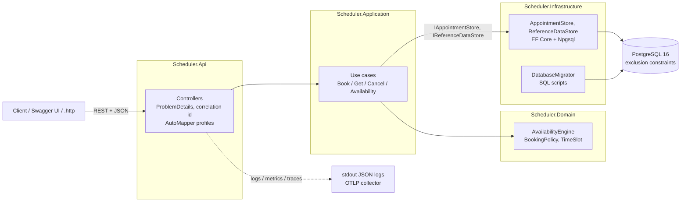
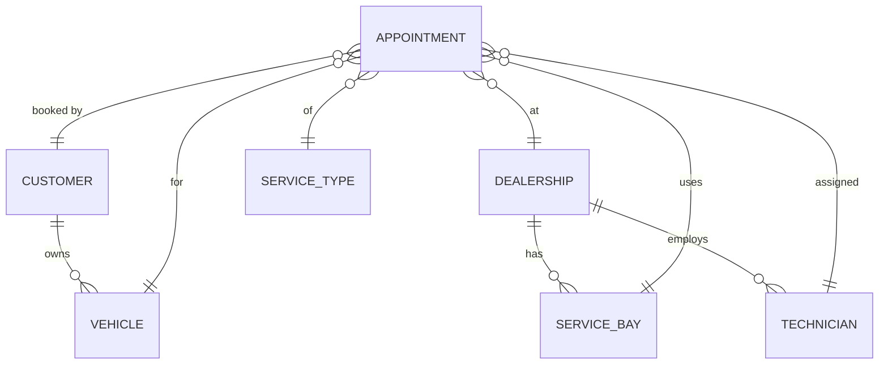
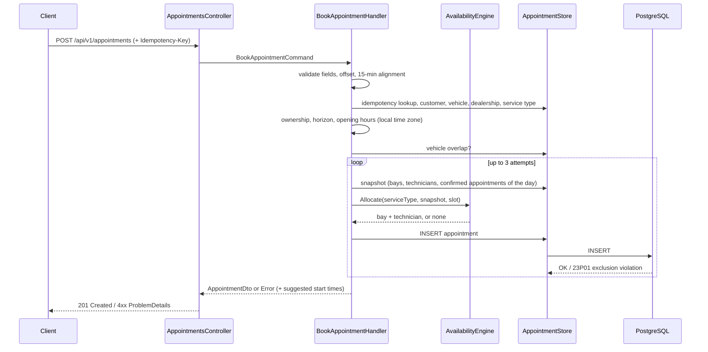

# System Design: Unified Service Scheduler

Status: Design approved, implementation in progress | Author: Duong Dinh Hanh | Scenario A – The Unified Service Scheduler | Implemented layer: **Backend** (REST API + PostgreSQL); client stubbed with OpenAPI, Swagger UI, `.http` file and cURL | Related: [SPEC.md](../SPEC.md)

## 1. Overview
Dealerships need a single place to book service appointments. A booking is only valid when the
dealership has, for the entire service window, a **service bay of the right type** and a
**technician with the required qualification**. The system answers a booking request in real time
with either a confirmed appointment (customer, vehicle, technician, bay, time window) or a clear
rejection with alternative start times. Its core guarantee: **no bay, technician or vehicle is ever
double-booked**, including under concurrent requests and with several API instances.

## 2. Architecture

Clean Architecture: Domain has no dependencies, Application depends only on Domain and defines the
store ports, Infrastructure implements them, Api composes everything. Domain and Application use
only the .NET base library, so the business logic is fully unit-testable.

## 3. Components
| Component | Responsibility |
|---|---|
| `Scheduler.Api` | Thin controllers (`AppointmentsController`, `AvailabilityController`, `ReferenceDataController`), request binding, mapping DTOs to responses (AutoMapper), mapping domain errors to ProblemDetails (400/404/409/422), correlation id, health checks, OpenAPI 3.1, Serilog and OpenTelemetry wiring |
| `BookAppointmentHandler` | Orchestrates a booking: validate → load references → policy checks → allocate → persist → retry on concurrent conflict → suggestions; idempotency |
| `AvailabilityEngine` | Pure function: given a service type, a resource snapshot and a slot, returns a bay + technician or nothing; also enumerates free start times |
| `BookingPolicy` | Time rules: 15-minute alignment, booking horizon (60 min – 60 days), opening hours in the dealership time zone |
| `AppointmentStore` / `ReferenceDataStore` | Queries and inserts; translates PostgreSQL constraint errors into typed results by constraint name |
| `DatabaseMigrator` | Applies embedded, forward-only SQL scripts and seed data on start-up |
| PostgreSQL | Source of truth; exclusion constraints enforce no overlap per bay, technician and vehicle |

## 4. Data Model

- `service_types` carries `duration_minutes`, `required_qualification`, `required_bay_type`.
- `technicians.qualifications` is an integer array (simple, no join table needed at this scale).
- `appointments` stores `start_utc` / `end_utc` (`timestamptz`), `status`, and `idempotency_key` + `request_hash`.
- Three exclusion constraints, each `EXCLUDE USING gist (<resource_id> WITH =, tstzrange(start_utc, end_utc, '[)') WITH &&) WHERE (status = 'Confirmed')`, for bay, technician and vehicle. Cancelled rows never block.

## 5. Data Flow: Booking an Appointment

## 6. Concurrency & Data Integrity
A read-then-write check in application code is not enough: two requests can both read "bay free"
and both insert. The design therefore splits responsibilities:
- **Application check** (snapshot + engine): picks the best bay/technician and produces meaningful
  errors and suggestions.
- **Database guarantee** (exclusion constraints): the second conflicting insert fails atomically with
  SQLSTATE `23P01`, no matter how many API instances run.
- **Recovery**: on `23P01` for a bay or technician (or a `40P01` deadlock) the handler re-reads the
  snapshot and tries the remaining resources, up to 3 attempts, then returns 409 with suggestions.
  A `23P01` on the vehicle constraint returns `VEHICLE_ALREADY_BOOKED` without retry.
- **Idempotency**: a unique partial index on `idempotency_key` plus a request hash makes client retries safe.

Why not a version column checked in the API? A version protects an *existing* row being updated;
here the conflict is between two *inserts* of new rows, and a check in the API server is a
check-then-write race across instances. A version token (`xmin`) is still a fit for cancelling an
existing appointment.

To be proven by integration tests AC-02.1 – AC-02.3: 10 parallel bookings for one bay and one
technician must yield exactly 1 × 201 and 9 × 409.

## 7. Technology Choices & Justification
| Choice | Alternatives considered | Why chosen |
|---|---|---|
| .NET 10 Web API with Controllers | Minimal APIs, Node.js | Current LTS, fast, strong typing; controllers give a conventional, reviewable structure per resource with built-in model validation and rich OpenAPI metadata |
| PostgreSQL 16 | SQL Server, MongoDB | Native range types and exclusion constraints solve the core no-overlap problem declaratively; open source, easy to run in Docker |
| EF Core + Npgsql | Dapper | Productive mapping and LINQ; raw SQL used where EF cannot express the schema |
| SQL-script migrations | EF Core migrations | Exclusion constraints are raw SQL anyway; scripts are short, reviewable and testable in `psql` |
| AutoMapper 14.x (MIT), Api layer only | Hand-written mapping, Mapperly | Familiar to the developer; its main risk (silent mapping errors) is covered by a configuration-validity test |
| Direct use-case injection | MediatR | Four use cases do not justify a mediator; direct calls are easier to read and debug |
| Hand-written validation | FluentValidation | Single request type; keeps core projects package-free |
| Serilog (compact JSON) | Built-in console logger | Structured logs with correlation id, ready for log aggregation |
| OpenTelemetry | Vendor SDKs | Vendor-neutral metrics and traces, OTLP export to any backend |
| Built-in OpenAPI (`Microsoft.AspNetCore.OpenApi`) + Swagger UI | Swashbuckle SwaggerGen | First-party in .NET 10, OpenAPI 3.1; doubles as the client contract stub required by the brief |
| xUnit + FluentAssertions | NUnit, MSTest | De-facto standard; traits carry AC IDs for traceability |
| Testcontainers | EF InMemory, SQLite | Only real PostgreSQL can prove the exclusion constraints |
| Docker Compose | Local installs | One command to run API + database |

## 8. Observability Strategy
- **Logs:** JSON to stdout (Serilog), enriched with `correlationId` (from `X-Correlation-Id` or generated, echoed in the response), request logging, booking outcomes with appointment / dealership ids. No customer PII.
- **Metrics:** `scheduler.booking.requests{result}`, `scheduler.booking.duration` (ms), `scheduler.concurrency.conflicts{constraint}`, plus ASP.NET Core and Npgsql instrumentation.
- **Traces:** HTTP server spans, Npgsql command spans, and a custom `AvailabilityEngine.Allocate` span.
- **Health:** `/health/live` (process) and `/health/ready` (database reachable) for orchestrator probes.
- **Example alerts:** p95 booking duration > 500 ms for 5 min; `unavailable` ratio spike per dealership (capacity issue); sustained growth of `concurrency.conflicts` (hot slots); readiness failing.

## 9. Quality Attributes ("Build for the Future")
| Attribute | How the design addresses it |
|---|---|
| Scalability | Stateless API, integrity enforced in the database, so instances scale horizontally; queries bounded to one dealership and one day |
| Performance | One snapshot query per booking attempt instead of one query per slot; allocation is in-memory; targeted index plus GiST constraint indexes; targets to be verified with k6 (SPEC §10) |
| Reliability | Exclusion constraints make double-booking impossible; retries on concurrent conflicts; idempotent POST via `Idempotency-Key`; DB errors never surface as 500; readiness probe |
| Maintainability | Clean Architecture boundaries, package-free Domain/Application, thin controllers, requirement IDs (FR/BR/AC) traced into tests and commits, central package management, `AGENTS.md` for consistent AI-assisted changes |
| Observability | Structured logs with correlation id, business metrics, distributed traces, health endpoints (section 8) |
| Security | Input validated at the boundary, parameterised queries only, no secrets in code (env vars), dependency audit as build errors, no PII in logs. Authentication is out of scope (A-07) |

## 10. Future Evolution
- Technician shifts and leave, bay maintenance windows, holiday calendars, buffer time between jobs.
- Outbox events (`AppointmentConfirmed`) for notifications and DMS integration.
- Caching reference data; read replicas for availability; partitioning appointments by dealership or month at large scale.
- Authentication with customer identity from the token, and ownership checks on read and cancel.

## 11. Assumptions
The brief leaves several rules open. These are the assumptions taken (full table with impact in [SPEC.md §15](../SPEC.md#15-assumptions), open questions in [§16](../SPEC.md#16-open-questions)):

| # | Assumption |
|---|---|
| A-01 | Bookings are confirmed instantly; there is no advisor approval step |
| A-02 | Technicians are available for all opening hours (no shifts, breaks or leave) |
| A-03 | One appointment = one service type, one technician, one bay |
| A-04 | Duration is fixed per service type; no buffer between jobs |
| A-05 | The system assigns technician and bay automatically: least-loaded technician of the day, then bay by name |
| A-06 | Customers and vehicles already exist (seeded / owned by another system) |
| A-07 | No authentication; the caller passes `customerId`, which must own the vehicle |
| A-08 | Same opening hours every open day; public holidays ignored |
| A-09 | A single technician performs the whole job |
| A-10 | Every dealership offers every service type |
| A-11 | Idempotency keys are global and never expire |
| BR-05 | The whole service must fit within opening hours of one day, in the dealership's time zone |
| BR-06 | Bookings start at least 60 minutes and at most 60 days ahead |
| BR-07 | Start times align to 15-minute slots; the client must send an explicit UTC offset |
| BR-12 | Any future confirmed appointment can be cancelled without fee; cancelled appointments free their resources |

## 12. Use of GenAI in the Design Process
- **Spec structure:** AI proposed a spec-driven structure (requirements → design → tasks, EARS / Given-When-Then acceptance criteria, in the style of Kiro and GitHub Spec Kit).
- **Critical review:** AI reviewed the developer's first spec draft and found gaps: status contradicting the Definition of Done, constraint violations not distinguished by resource, missing idempotency edge cases, no order between validation errors, acceptance criteria depending on the test run time.
- **Requirement analysis:** AI mapped the brief's three core requirements to FR/BR/AC with IDs and surfaced ambiguities (approval step, buffers, allocation strategy, horizon, time zone, idempotency scope) as Open Questions with proposed defaults.
- **Design challenge:** the developer asked why not use a version column checked in the API server; AI explained the insert-vs-update distinction and the check-then-write race, which confirmed the exclusion-constraint design plus retry (section 6).
- **Corrections from the human side:** switched Minimal APIs to Controllers; chose AutoMapper over the AI's recommendation of hand-written mapping, with guard rails; asked for explanations of every table and of the constraint syntax before accepting them; stopped the AI when it started generating code before the spec was committed.
- **Verification plan:** AI-generated logic is not accepted on trust: tests are written from ACs first, the schema is exercised on real PostgreSQL via Testcontainers, and no result is reported without its actual output. Details in [ai-collaboration-log.md](ai-collaboration-log.md).
